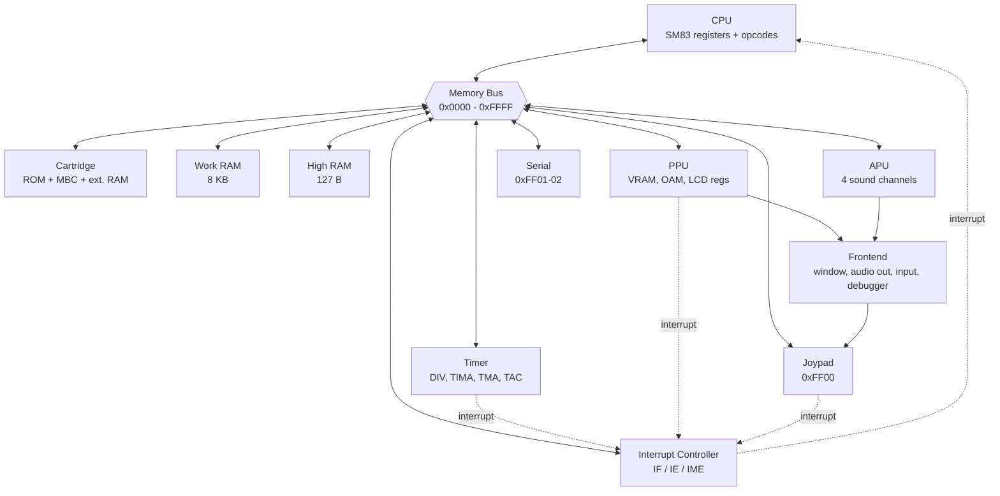

# Game Boy (DMG) Emulator: Project Overview

> Status: **Day 1 of 42** | Language: `<C++>`

## 1. Goal

Build a working emulator of the original Nintendo Game Boy (DMG-01) from scratch, one small verified step per day over 42 days, and document every stage well enough to present the project from start to finish.

The emulator should:

- Run commercial and homebrew ROMs correctly (Tetris, Pokémon Red/Blue, Link's Awakening)
- Pass the standard community test ROMs (Blargg, Mooneye, dmg-acid2)
- Include a debugger (registers, memory, tile viewer, stepping) that doubles as a live-demo tool
- Have a documentation trail showing *how* each component was built, tested, and debugged

## 2. Scope

| In scope | Out of scope (possible future work) |
|---|---|
| Original DMG (monochrome) | Game Boy Color (CGB) |
| SM83 CPU, all 512 opcodes | Super Game Boy features |
| Timers, interrupts, HALT | Link cable multiplayer |
| Scanline-based PPU (BG, window, sprites) | Cycle-accurate PPU FIFO |
| MBC1, MBC3 (with RTC), MBC5 | Rare mappers (MBC2, MBC6, MBC7, HuC1) |
| 4-channel APU | Boot ROM emulation (post-boot register values used instead) |
| Battery saves, save states | Netplay, rewind, shaders |

## 3. Target Hardware at a Glance

| Component | Specification |
|---|---|
| CPU | Sharp SM83 (Z80/8080 hybrid), 4.194304 MHz |
| Work RAM | 8 KB |
| Video RAM | 8 KB |
| Screen | 160 × 144 pixels, 4 shades of grey |
| Refresh rate | ~59.7 Hz (70,224 CPU cycles per frame) |
| Sound | 4 channels: 2 pulse, 1 wave, 1 noise |
| Input | D-pad plus A, B, Start, Select |
| Cartridge | ROM plus optional mapper (MBC), external RAM, battery, RTC |

## 4. Architecture

Everything the CPU touches goes through a central **memory bus**. This is the key design decision: the CPU never talks to components directly, it only reads and writes addresses.



*(If your viewer does not render Mermaid, replace this block with an exported image of your hand-drawn block diagram: ``.)*

### Main loop (planned)

```
while running:
    cycles = cpu.step()          # execute one instruction, return cycles used
    timer.tick(cycles)
    ppu.tick(cycles)
    apu.tick(cycles)
    handle_interrupts()
    if frame_complete:           # every 70,224 cycles
        present_frame()
        poll_input()
        sync_to_59.7_hz()
```

## 5. Memory Map

| Address range | Size | Region |
|---|---|---|
| `0x0000 - 0x3FFF` | 16 KB | ROM bank 0 (fixed) |
| `0x4000 - 0x7FFF` | 16 KB | ROM bank 1..N (switchable via MBC) |
| `0x8000 - 0x9FFF` | 8 KB | Video RAM (tiles and tile maps) |
| `0xA000 - 0xBFFF` | 8 KB | External cartridge RAM (switchable) |
| `0xC000 - 0xDFFF` | 8 KB | Work RAM |
| `0xE000 - 0xFDFF` | ~7.5 KB | Echo RAM (mirror of `0xC000 - 0xDDFF`) |
| `0xFE00 - 0xFE9F` | 160 B | OAM (sprite attribute table) |
| `0xFEA0 - 0xFEFF` | 96 B | Unusable |
| `0xFF00 - 0xFF7F` | 128 B | I/O registers (joypad, serial, timer, APU, LCD, DMA) |
| `0xFF80 - 0xFFFE` | 127 B | High RAM |
| `0xFFFF` | 1 B | Interrupt Enable register (IE) |

## 6. Milestones

| Milestone | Days | Definition of done |
|---|---|---|
| **M1: CPU** | 1-14 | All 11 Blargg `cpu_instrs` tests pass |
| **M2: Timing** | 15-21 | Timers, interrupts, HALT; `instr_timing` and `interrupt_time` pass |
| **M3: Graphics and mappers** | 22-35 | `dmg-acid2` passes; Tetris and Pokémon playable with saves |
| **M4: Audio and tooling** | 36-42 | Sound works; debugger complete; final demo ready |

**Minimum viable demo (cut line):** end of Day 35. Audio and debugger are bonus.

## 7. Testing Strategy

Test ROMs are treated as the specification. A day is not finished until its verification step passes.

| Area | Tool |
|---|---|
| CPU instructions | Blargg `cpu_instrs` (11 ROMs, run individually first) |
| CPU state correctness | Gameboy Doctor log comparison |
| Instruction/memory timing | Blargg `instr_timing`, `mem_timing` |
| Interrupts and HALT | Blargg `interrupt_time`, `halt_bug`; Mooneye |
| PPU | `dmg-acid2`, Mooneye PPU tests |
| Audio | Blargg `dmg_sound`, listening tests |
| Real-world | Tetris, Super Mario Land, Pokémon Red/Blue, Link's Awakening |

Blargg's ROMs report results over the serial port (`0xFF01` / `0xFF02`), which the emulator prints to the console from Day 11.

## 8. Project Structure

```
gb-emulator/
├── src/              # emulator source
│   ├── cpu           # registers, opcodes, CB opcodes
│   ├── bus           # memory map and routing
│   ├── cartridge     # header parsing, MBCs, saves
│   ├── ppu           # modes, rendering
│   ├── apu           # sound channels
│   ├── timer         # DIV/TIMA
│   ├── joypad        # input matrix
│   └── frontend      # window, audio output, debugger UI
├── docs/             # this documentation
├── roms/             # test ROMs (not committed if copyrighted)
├── tests/            # unit tests and test-ROM runner
└── README.md
```

## 9. Documentation Plan

| File | Written during | Contents |
|---|---|---|
| `00-overview.md` | Day 1 | This document |
| `01-cpu.md` | Days 3-14 | Registers, flags, opcode design, DAA, test results |
| `02-memory-bus.md` | Day 2 onward | Memory map, routing, mappers |
| `03-timing-interrupts.md` | Days 15-21 | Cycle model, timers, interrupt flow, HALT quirks |
| `04-ppu.md` | Days 22-30 | Modes, tile format, rendering pipeline, sprites |
| `05-cartridge-mappers.md` | Days 33-35 | Header, MBC1/3/5, battery saves |
| `06-apu.md` | Days 36-39 | Channels, frame sequencer, resampling |
| `07-debugger.md` | Days 40-41 | Debugger features and screenshots |
| `08-bugs-and-lessons.md` | Ongoing | Bug log with root causes |
| `devlog.md` | Daily | 5-line entry per day |

## 10. References

- **Pan Docs**: https://gbdev.io/pandocs/ (primary hardware reference)
- **Opcode tables**: https://gbdev.io/gb-opcodes/optables/
- **Gameboy Doctor**: https://github.com/robert/gameboy-doctor (CPU state log comparison)
- **Blargg test ROMs** and **Mooneye test suite**: via the gbdev test ROM list
- **dmg-acid2**: https://github.com/mattcurrie/dmg-acid2
- **Game Boy CPU Manual** and **The Cycle-Accurate Game Boy Docs** for deeper detail

## 11. Day 1 Checklist

- [ ] Language and display library chosen
- [ ] Repo created and first commit made
- [ ] Project builds and runs (console message or blank 160×144 window)
- [ ] Architecture diagram drawn and linked above
- [ ] First entry added to `devlog.md`
- [ ] Screenshot saved
